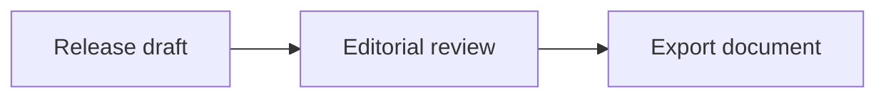

# More tools

## Mermaid: release flow

A fenced `mermaid` block renders a diagram. The slash menu can also insert a Mermaid block; its preview offers zoom and expand controls.

The arrows belong to the diagram. Connections between notes use [Markdown links](02-Links-and-Map.md).

## Math: review progress

Inline math uses single dollar signs, as in $p = c / n$. Block math uses double dollar signs:

$$
p = \frac{6}{8} = 75\%
$$

In this sample, six of eight sections have been reviewed. Both math forms are available from the slash menu in [editing mode](01-Writing.md).

## AI writing assistant

Configure a provider or local model in **Settings**, then select text and choose **Ask AI** for a rewrite, summary, or explanation. Suggestions can be accepted, abandoned, or stopped during generation. A remote provider receives text used for the request; the selected model and privacy information describe that use.

## Terminal and settings

**Open Terminal** shows a panel for commands on your computer. Its current directory determines where commands run. The default shell in Settings applies to new or restarted terminal tabs.

Settings also include appearance, editor behavior, and shortcuts. WebDAV connections are covered in [Sync, history, and export](05-Sync-and-History.md).

[Guide contents](00-Start-Here.md)
