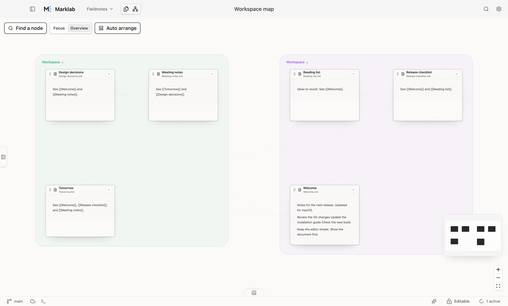

## Two ways to write

**Rich text** works well for everyday writing: headings, paragraphs, lists, tables, and code blocks.

**Source** gives you direct access to Markdown and code. Switch with the editing-mode control in the toolbar.

Both views work with the same document.

## A folder is a workspace

A workspace corresponds to a local folder. Open and organize notes in the file list, and move between documents using tabs.

Use the recent-workspace menu to return to a folder. If a folder moves or an external disk is disconnected, restore its path or select it again.

## Search and shortcuts

Double-tap Shift for global search. Toggle the sidebar with `⌘⇧L` on macOS or `Ctrl+Shift+L` on Windows and Linux.

Find the complete list under Settings → Shortcuts.

## Connect notes

Link to another note:

```md
Continue with [[Next steps]].
```

The graph helps you explore connections. Your folders continue to organize the underlying files.



## Focus modes

Settings → Editing includes Zen mode to hide surrounding interface elements, and Focus mode to soften content outside the current writing area.
