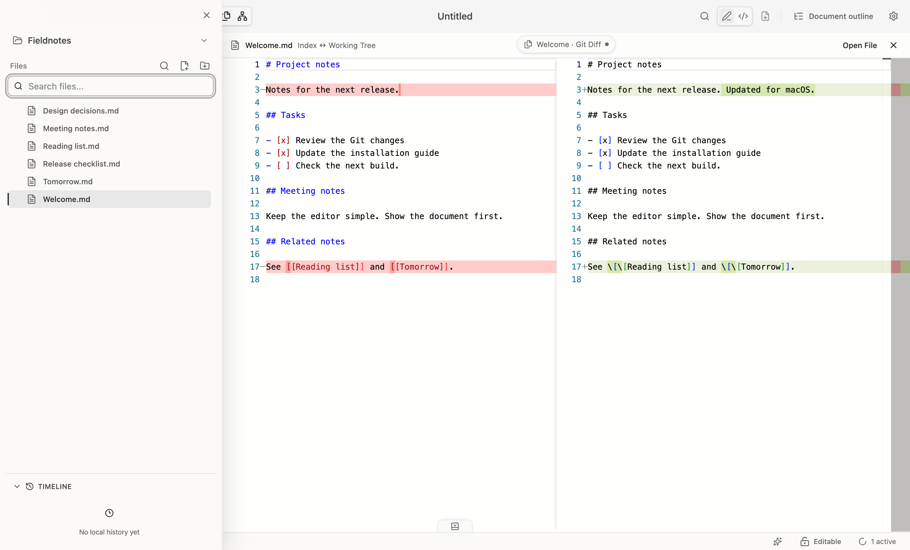

使用 Git 功能需要本机已安装 Git，工作区也是一个 Git 仓库。远程推送继续使用你已有的 Git 认证配置。

## 查看与提交

从工作区菜单选择“源代码管理”，或使用底部状态栏的 Git 按钮打开面板。

1. 点击已修改文件，查看差异。
2. 将需要提交的文件暂存。
3. 输入提交说明，提交暂存内容。
4. 配置远程仓库后，按需拉取、推送或获取远程更新。

前台 Git 状态会自动刷新；执行仓库操作后也会更新。

## 历史、分支与 Stash

仓库管理对话框提供提交历史、分支和 Stash。可以查看历史修改、切换分支，或暂存尚未完成的工作。

回滚和丢弃修改会改变文件内容，请先检查确认对话框中的范围。回滚操作会保留可恢复的备份分支。

## 解决冲突

冲突文件默认进入 Diff 合并视图：选择需要保留的内容，编辑合并结果，然后保存；确认解决后可保存并暂存。

如果外部操作改变了文件或冲突状态，先重新加载最新内容，避免覆盖后来发生的修改。

## 图片和其他文件

支持的文件类型优先进入内置预览或编辑器。无法内置预览的文件可用系统默认应用打开。

暂存和历史文件打开对应的只读版本。二进制冲突不会进入文本合并编辑器，需要使用相应工具处理后再暂存。
